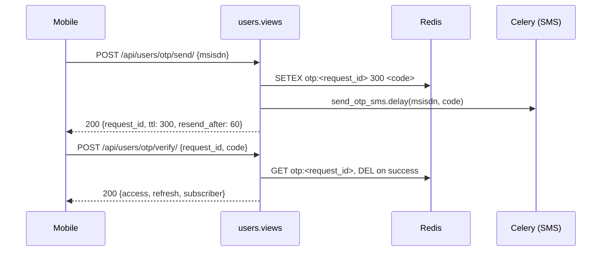

# Authentication

Three mechanisms, tried in this order for every DRF request (copied from
aikhan-internal's chain, with the LDAP step replaced by MSISDN + OTP):

```python
REST_FRAMEWORK["DEFAULT_AUTHENTICATION_CLASSES"] = [
    "apps.users.authentication.StaticTokenAuthentication",      # Token <key>, service-to-service
    "rest_framework_simplejwt.authentication.JWTAuthentication", # Bearer <jwt>, mobile
    "rest_framework.authentication.SessionAuthentication",      # admin / browsable API
]
```

## 1. Mobile login — MSISDN + OTP → JWT `:todo`

The mobile app has **no login screen yet** (it opens straight on Home for
`051 664 33 42`), so the flow is specified here and tagged `:todo` until
the screen exists.



Rules:

- `msisdn` is normalised to `994XXXXXXXXX` (`apps/users/utils/msisdn.py`);
  the app displays `051 664 33 42`, the API always exchanges the
  normalised form,
- OTP is 6 digits, valid 5 minutes, 5 attempts, resend after 60 s,
  3 sends per MSISDN per hour (Redis counters),
- in `DEBUG` the code `000000` is always accepted so the seeded subscriber
  can log in without an SMS gateway,
- a `Subscriber` row is created on first successful verify,
- JWT: access 30 min, refresh 30 days, rotation on, blacklist on logout.

## 2. Static API tokens (service-to-service)

`StaticTokenAuthentication` matches `Authorization: Token <key>` against
`settings.API_TOKENS` and yields a synthetic token user
(`is_api_token = True`), exactly like aikhan-internal. Used by:

- the referral registration webhook `:todo`,
- future BSS callbacks (`# TODO(bss)`),
- the real assistant service when it replaces the dummy.

`IsServiceAPIKey` (`apps/users/permissions.py`) checks
`settings.SERVICE_API_KEY` for those endpoints.

## 3. Session (admin only)

`/mgmt/` and the browsable API.

## Permissions

| Class | Rule |
|---|---|
| `IsSubscriber` | `request.user` is a `Subscriber` with an active line. Default for every mobile endpoint. |
| `IsOwner` | object-level: `obj.subscriber_id == request.user.id`. Applied to transactions, activations, conversations, saved accounts. |
| `IsServiceAPIKey` | machine callers. |
| `IsPremium` `:todo` | subscriber's current tariff family is `premium-plus`; gate for the Premium theme. |

## Device and app headers

The mobile client sends `X-App-Version: 5.1.0 (13557)` and
`X-Platform: ios|android|web`. Both are stored on `RequestLog` and on
`Device` (push token registration, `:todo`).

## Logout `:todo`

`POST /api/users/logout/` blacklists the refresh token. The More tab's
"Sign out" row still shows a prototype notice, so the endpoint is reserved.
