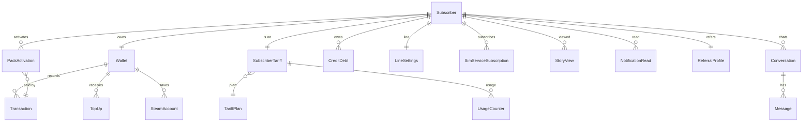

# Data Models

Survey of the models each app owns. Field lists are the ones that matter
for relationships and request flow; exact types live in `models/`.

## `apps.users`

- **`Subscriber`** — custom `AUTH_USER_MODEL`. `msisdn` (unique, `994…`),
  `display_name` ("Qüdrət Abidzadə"), `line_type` (`prepaid` / `postpaid`),
  `language` (`en|az|ru`), `is_active_line`, `created_at`. Everything else
  hangs off this row.
- **`OtpRequest`** — audit of OTP sends and verifies (`msisdn`,
  `request_id`, `sent_at`, `verified_at`, `attempts`). The live code is in
  Redis, not here.
- **`Device`** `:todo` — push token per installation (`platform`, `token`,
  `app_version`, `last_seen_at`).
- **`RequestLog`** — one row per HTTP request (middleware).

## `apps.billing`

- **`Wallet`** — one per subscriber. `balance` (Decimal), `currency`
  (`AZN`), `updated_at`. Row-locked on every change.
- **`Transaction`** — `wallet` FK, `kind`
  (`top_up|purchase|credit|refund`), `amount` (signed), `title` (the string
  the app shows), `reference` (generic FK to the activation / top-up /
  steam order), `created_at`.
- **`TopUp`** — `wallet` FK, `method` (`card|akart|voucher|google_pay`),
  `amount`, `status` (`completed` now; `pending|failed` once a real
  acquirer exists), `card_bin`, `akart_msisdn`, `voucher_code`,
  `provider_ref`, `created_at`. The Home "Top-ups in October" figure is
  `SUM(amount)` for the current month; the Top-ups history page lists
  these rows.
- **`SavedCard`** — `wallet` FK, `brand`, `last4` ("4471"), `expiry`
  ("09/28"), `is_default`. Seeded with one card.
- **`SavedAkart`** — `wallet` FK, `msisdn`, `created_at` (the "Save akart
  number" checkbox).
- **`SteamAccount`** — `wallet` FK, `name` (Steam login), `last_amount`,
  `last_topped_at`. Unique per (wallet, lower(name)).
- **`SteamTopUp`** — `steam_account` FK, `amount` (1.00–50.00),
  `transaction` FK.
- **`IdempotencyKey`** — `key`, `subscriber`, `response_json`,
  `created_at`.

## `apps.tariffs`

- **`TariffFamily`** — `slug` (`digimax`, `premium-plus`, `istesen`),
  `name`, `subtitle`, `badges` (JSON: `["PREPAID"]`), `is_premium`,
  `default_plan`.
- **`TariffPlan`** — `family` FK, `slug` (`digimax-10`), `title`, `price`,
  `is_hot`, `period_days` (28), `socials` (JSON), `features` (JSON list of
  `{kind,label,value,socials?}`), `is_new`, `tagline`.
- **`OverageRate`** — `label` ("Internet - 1 MB"), `price`, `group`
  (`after_package|unpaid`).
- **`SubscriberTariff`** — `subscriber` OneToOne, `plan` FK, `monthly_fee`
  (19.10), `activated_at`, `last_payment_at`, `next_payment_at`,
  `period_days` (30), `status`.
- **`UsageCounter`** — `subscriber_tariff` FK, `kind`
  (`internet|messaging|calls`), `remaining`, `total`, `unit`
  (`GB|MB|MIN`), `period_ends_at`. Feeds Home "Remaining balance", the
  Remaining balance page and the IsteSen page.
- **`RedesignDraft`** `:todo` — `subscriber` FK, slider values, estimated
  price, `apply_at` (next renewal).
- **`PremiumBenefit`** — `key`, `text`, `order`.

## `apps.packs`

- **`PackCategory`** — `slug` (`unlimited|high-volume|weekly|daily|social`), `label`, `order`.
- **`InternetPack`** — `category` FK, `slug`, `name`, `sub`, `price`,
  `renews`, `label`, `validity_hours`, `volume_mb` (null for unlimited).
- **`SocialPack`** — `slug` (`tehsil`, `instagram-facebook`, `tiktok`,
  `youtube`), `title`, `subtitle`, `app`, `range`, `special`, `volume`,
  `periods` (JSON), `auto_renew`, `cta` (`Activate|Subscribe`).
- **`SocialPackPlan`** — `pack` FK, `slug`, `title`, `price`, `validity`.
- **`RoamingPack`** — `slug`, `name`, `sub`, `price`, `validity_days`.
- **`PackActivation`** — `subscriber` FK, generic FK to the pack / plan,
  `status` (`active|expired|cancelled`), `activated_at`, `expires_at`,
  `auto_renew`, `transaction` FK.

## `apps.kredit`

- **`CreditProduct`** — `slug` (`simkredit|simtaksit|internetkredit|ekstrakredit`),
  `name`, `subtitle`, `chip`, `chip_icon`, `price`, `amount`, `fee`,
  `amount_mb`, `validity_days`, `order`.
- **`CreditDebt`** — `subscriber` FK, `product` FK, `amount`, `fee`,
  `taken_at`, `repaid_at`. Home / Get Kredit "Debt" is the open sum
  (seeded 0, "no items").
- **`TamamlaStep`** — ordered copy for the Tamamla page; the CTA is an
  external deep link (`https://links.akart.az/app/`).

## `apps.sim`

- **`LineSettings`** — `subscriber` OneToOne, `status` (`open|closed`),
  `mobile_internet`, `second_line`, `lte_enabled`, `one_way_blocking_at`,
  `deactivation_at`, `line_closure_fee` (20.00), `suspend_until`.
- **`CallForwarding`** — `subscriber` OneToOne, `all_calls`, `unanswered`,
  `busy`, `unreachable` (booleans). Rule: `all_calls=true` forces the
  other three to `false`.
- **`RoamingSettings`** — `subscriber` OneToOne, `enabled`, `changed_at`.
- **`SmsSettings`** — `subscriber` OneToOne, `language` (`az|en|ru`),
  `ads`, `campaigns`, `partners`.
- **`PukCodes`** — `subscriber` OneToOne, `puk1`, `puk2` (encrypted at
  rest, returned masked unless `?reveal=1`).
- **`SimService`** — `slug` (`missed-call`, `auto-balance`), `name`,
  `sub`, `period`, `price`, `badge`, `sections` (JSON), `action` (JSON).
- **`SimServiceSubscription`** — `subscriber` FK, `service` FK, `status`,
  `activated_at`, `next_payment_at`, `transaction` FK.
- **`EsimRequest`** `:todo` — `subscriber` FK, `kind`
  (`transfer|recover`), `recovery_code`, `status`.

## `apps.content`

- **`Story`** — `key` (`gift-wheel`, `30il`, `wolt`, `roaming`,
  `especially`, `applications`, `dark-mode`), `title`, `thumb`,
  `pages` (JSON, the `StoryPage` shape from `src/data/stories.ts`),
  `order`, `published_at`.
- **`StoryView`** — `subscriber` FK, `story` FK, `viewed_at`. Viewed chips
  move to the end of the shelf.
- **`Banner`** — `key`, `placement` (`home|products|benefits|partners`),
  `image`, `alt`, `deep_link` (`/kredit/tamamla`, `/tariffs/digimax`, …,
  null when the target is `:todo`), `order`, `published_at`.
- **`Notification`** — `subscriber` FK (null = broadcast), `title`,
  `body`, `cta`, `sent_at`.
- **`NotificationRead`** — `subscriber` FK, `notification` FK, `read_at`.
- **`LotterySection`** — `icon`, `title`, `blocks` (JSON), `order`.
- **`Game`** — `slug`, `name`, `image`, `is_reward`, `order`.
- **`Tournament`** — `title`, `prize` ("5 GB"), `ends_at`,
  `participants` (6 708), `game` FK.
- **`AppOffer`** — Kinon / Yandex Plus / Litres (`name`, `description`,
  `from_price`, `monogram`, `color`).
- **`AztelekomOffer`** — single row (`title`, `price`, `bundle`, `speed`).
- **`Campaign`** — `title`, `image` ("Azercellim.com campaign").
- **`AppRating`** — `subscriber` FK, `stars` (1–5), `created_at`.

## `apps.referral`

- **`ReferralProfile`** — `subscriber` OneToOne, `code` (`wa16Kg`),
  `earned` (Decimal), `share_url`.
- **`ReferralEvent`** `:todo` — `referrer` FK, `invited_msisdn`,
  `registered_at`, `qualified_at`, `bonus_paid_at`.

## `apps.assistant`

- **`Conversation`** — `subscriber` FK, `external_id` ("#3513323"),
  `title`, `channel` (`mobile`), `status` (`open|closed`), `created_at`,
  `last_message_at`, `unread_count`.
- **`Message`** — `conversation` FK, `role` (`user|assistant|system`),
  `content`, `route` (dummy intent), `tokens_in`, `tokens_out`, `cost`,
  `latency_ms`, `created_at`.
- **`ConversationRating`** — `conversation` OneToOne, `stars`, `comment`.

## Cross-app relationships

